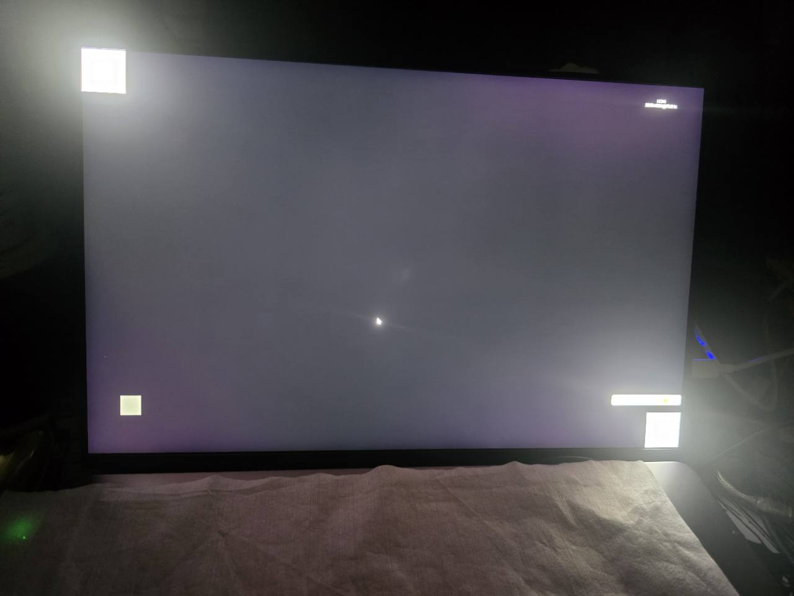
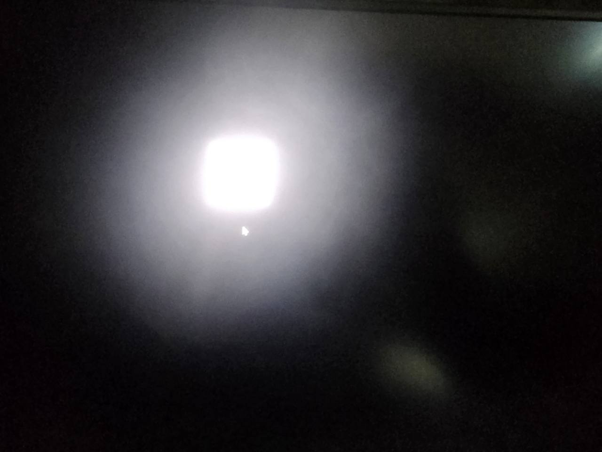

# A ¥400 Portable Mini LED Got Its Local Dimming Back

[简体中文](README.md) · **English**

A salvaged BOE panel, a multi-input controller board, and a repair I was too stubborn to give up on.

Bought a used portable Mini LED for ¥600, got ¥200 back, so ¥400 in the end. Bright screen, but black backgrounds were gray and purple — looked like an ordinary LCD with the backlight stuck on. Seller said local dimming was on by default. Not what I was seeing.

Almost gave up and treated it as a regular IPS. But I kept wondering: if the panel has the hardware, what's stopping it?

Opened it up, identified the panel and controller, and with AI assistants traced the path from the PC through controller firmware, downstream panel interface, and backlight initialization. On this specific hardware, I found a way to make local dimming actually work.

If this counts as mysterious Eastern magic, it mostly consists of buying something for ¥400 and refusing to give up.

## Current status

**Local dimming works in daily use. The OSD toggle button has no visible effect.**

Both are true. The control bits change on readback when you press the button, but the black level doesn't follow. Whether a power cycle would help — no idea, didn't test it. I'm happy with local dimming staying on and done chasing the toggle.

The public build disables the toggle and keeps brightness, audio, scenes, status readback, and test patterns.

## The two photos

### Before: a bright object, with most of the black background still gray and purple



### After: the bright object remains, and the surrounding screen can finally darken



Casual phone photos — framing and exposure differ, not a controlled measurement. There's still a visible halo in the second shot. The conclusion comes from looking at the real screen, not the photos.

## The hardware in this case

| Item | What I identified |
| --- | --- |
| Panel | BOE NE160QDM-NM4, label revision V8.5 |
| Controller PCB | JC2795L_R40.1, board sticker JC2795L001 |
| Controller identification | Chip marking: 2775QT / 071GCP1 / G036; CF23 read from register. RTK2775 is the external display ID |
| Connection | AMD GPU to the portable monitor over HDMI |
| Signal during the documented checks | 2560 × 1600 at 60 Hz |
| Final cost | ¥600 purchase minus ¥200 refund: ¥400 |

This doesn't mean every generic board can do it. One board, one panel, one firmware version. Other combinations need their own testing.

## How I found the initialization path

1. **Identify the hardware.** An EDID name is not a reliable substitute for a panel label or controller identification. I checked the labels, PCB markings and actual chip reads together.
2. **Separate picture output from backlight control.** A panel displaying an image does not establish that its local-dimming path has been initialized. My panel responded to a specific downstream control path.
3. **Find the startup conditions.** On this combination, writing Source OUI `00 AA 01`, waiting, and setting bit 3 of panel DPCD `0x344` reached a state in which I observed working local dimming.
4. **Put that sequence into startup.** I added a newly written 72-byte initialization stub to the verified firmware and changed its call site. The total number of differing bytes is also 72. My own installation was backed up and checked by a complete flash readback.

Writing the Intel OUI opens this control path on the panel — it doesn't turn the board into an Intel product.

See the [technical notes](docs/technical-notes.en.md) for patch details, addresses, and compatibility checks.

## MicroGlow OSD

I also broke the monitor's physical control wheel while opening it. That became a reason to build a Windows control panel.

- Monitor brightness, contrast, RGB gain, and supported color presets, sharpness and monitor-speaker volume.
- Windows default playback-device volume and mute.
- Standard, Office, Night Reading, FPS, Cinema and a saved personal recipe. Selection is matched against four actual settings, with an undo operation.
- Morning, Noon and Night UI themes, selected automatically by time or fixed manually. Themes do not adjust monitor brightness.
- A moving white square, an alternating checkerboard and a moving narrow bar. Space pauses, clicking positions the object, Tab changes the pattern and Esc returns.
- A tray icon, global hotkeys and recovery from invalid physical-monitor handles.

Software scenes are parameter recipes, not the manufacturer's FPS algorithm. FreeSync and HDR show read-only status, no fake switches. UI is in Simplified Chinese; docs are available in both Chinese and English.

**The local-dimming toggle has no visible effect; the public build sends no E8 write.** Without the research bridge extension, control status may be unreadable, but that doesn't mean local dimming isn't working.

## Using this repository

Buildable source code and a **local-file-only** startup patch generator. No vendor firmware, commercial databases, vendor DLLs, or private research history.

### Build the OSD

For a ready-to-run package, grab the Windows x64 zip from [Releases](https://github.com/shangshang21/microglow-miniled/releases/latest) and run `MicroGlow.exe`.

To build from source — Windows x64, .NET Framework 4.8, system C# compiler:

```powershell
powershell -NoProfile -File .\apps\MicroGlow\build.ps1
```

The output is `build/MicroGlow`. Keep `MicroGlow.exe`, `MainWindow.xaml` and `MicroGlow.ico` together. Copy `apps/MicroGlow/install.ps1` into that output directory to install it for the current user and create desktop shortcuts. Exit an older MicroGlow process before using a different build.

Currently matches one `RTK2775` display only — not a universal OSD. Launching it doesn't flash firmware.

### Generate a patch from your own backup

Requirements: Python 3.10 or later; no third-party Python packages.

```powershell
py .\tools\build_startup_patch.py --input "my-original-backup.bin" --output "my-local-startup-patch.bin"
```

Only accepts the reviewed firmware-code version. Preserves bank C configuration, rejects unknown versions or repeated patches. Configuration can vary between devices, but **every byte outside that bank must match the allowlist**. It generates a file — doesn't touch hardware.

The low-level flashing workflow is not packaged as a one-click installer. Read the [technical notes](docs/technical-notes.en.md) first. Please don't upload vendor firmware or full dumps in issues.

## Why this might be useful

The interesting part: you don't necessarily need an expensive dedicated board for local dimming. On my combination, a generic multi-input board with audio worked fine once the missing initialization was added.

One more direction worth trying for DIY builds. It doesn't need universal compatibility to be useful.

Haven't measured peak luminance, zone count, or color accuracy. The toggle experiment stops here.

## License and provenance

Code is licensed under [GPL-3.0-only](LICENSE). Commercial use is allowed; distributing covered programs or modified versions requires complying with the applicable source and license obligations.

This license **does not grant rights to vendor firmware**. A locally generated image still includes third-party software; licensing the generator does not make the full output image GPL-licensed. The two photographs are provided for this case report and are not included in the code's GPL grant. See [NOTICE](NOTICE.md).

If you have similar hardware, I hope this saves you a few dead ends. My little sun finally does more than just shine.
