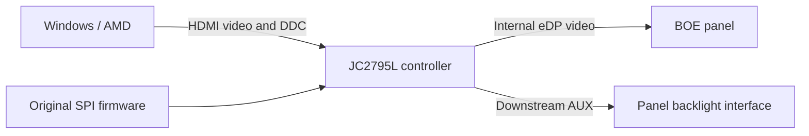

# What I changed on this hardware

[简体中文](技术说明.md) · **English** · [Home](../README.en.md)

Covers my JC2795L_R40.1 / JC2795L001 board, BOE NE160QDM-NM4 V8.5 panel, and the firmware-code allowlist in `tools/compatibility.json`. Includes the initialization stub and local file generator — no complete firmware or automatic flasher.

## The controller sits between HDMI and the panel



DDC brightness control doesn't give the PC direct HDMI access to the panel's eDP AUX. I used the controller's host-access interface and downstream AUX engine to reach panel-side state. Ordinary DDC, controller registers, and panel DPCD are three different layers.

EDID only helped confirm the connection target. `RTK2775` doesn't identify the panel or prove local-dimming support. Identification came from physical labels, PCB markings, CF23 chip read, and firmware layout together.

## The useful clue: Source OUI and a proprietary interface

The public Linux i915 implementation documents an Intel proprietary AUX backlight interface with a Source OUI wait mechanism. Used that as a hypothesis and checked the response on my device — not a Linux driver port.

| Panel address | Meaning used in this case |
| --- | --- |
| `0x300..0x302` | Source OUI |
| `0x340..0x343` | Proprietary interface capabilities |
| `0x341 bit3` | Segmented-backlight capability |
| `0x344 bit3` | Segmented-backlight control |

Initially OUI was `00 04 4B`, proprietary capabilities read zero, direct `0x344=08` was rejected. After writing `00 AA 01` and waiting, capabilities appeared and `0x344=08` could be written and read back. This is what happened on my device — other panels may differ.

Also tried standard eDP `0x721` bits. Readback changed but no visible effect at fixed brightness in SDR/HDR comparisons, so that route wasn't used.

## Exact startup patch scope

The original image is 1 MiB, organized as sixteen 64 KiB banks. The patch uses existing bank-4 functions and a verified empty area:

| Location | Original / purpose | Change |
| --- | --- | --- |
| File offset `0x4D3B8` | `12 FA 8F`, original NativeWrite call | `12 FF 00`, call the new stub |
| `0x4FF00..0x4FF47` | All `FF` | Newly written 72-byte 8051 stub |
| `0xC0000..0xCFFFF` | Bank C, existing configuration | Preserved in full |

The new sequence:

1. Save temporary RAM `2B/2C/2D` and perform the original NativeWrite.
2. Put `00 AA 01` in the buffer and reuse the firmware's write routine for panel address `0x300`.
3. Wait 750 timer ticks using the original firmware's delay mechanism.
4. Write panel `0x344=08`, restore the temporary RAM and return.

**750 ticks is not a precise 750 milliseconds.** Full bytes are in the [generator's STUB constant](../tools/build_startup_patch.py). Two bytes of the stub happen to be `FF`; the call-site edit changes two more. Full-image difference: also 72 bytes — but the actual flash update covered two 4 KiB sectors, backed up and verified by sector and full-image readback.

Didn't touch PQ decoding, color gamut, or HDR calibration. Working local dimming doesn't mean those are right.

## How the local generator restricts input

```powershell
py .\tools\build_startup_patch.py --input "my-original-backup.bin" --output "new-local-candidate.bin"
py -m unittest discover -s tests -v
```

Checks image length, then hashes **all bytes outside bank C**. Configuration can vary; everything else must match the reviewed version byte-for-byte. Also verifies the original call site, the 256-byte reserved area being all `FF`, permitted offsets, 72 actual differences, output code digest, and unchanged configuration. Rejects repeated patching.

Reference-image digests (for identification, not download):

- Original reference: `e82d6cef7836bdb29c6223285626509b4ae4abfd686bd1029b2c3d5d0d976852`
- v2 reference candidate: `e387973e7e407aae3eb51d3671c7434f03bacb7c901a2347c12572c82a2ffaa5`

Different configuration = different full-image digest. Code digests are in [compatibility metadata](../tools/compatibility.json).

The generator only reads and writes local files — no ISP, no GPU DLL, no monitor contact. If you can't independently back up and restore your board, generating a file isn't enough. The output still contains third-party firmware content; the tool's GPL doesn't cover that.

## The failure that belongs in the report

**Local dimming works overall. The PC toggle has no visible effect.** E8 and panel reads can report "off" while the display looks unchanged.

A later research bridge that also changed OUI at runtime didn't produce a visible toggle either. The public OSD keeps optional E8 reads, removes writes, and disables the toggle buttons and hotkey.

Whether power cycling would help is untested. Experiment stops here.

## What each check establishes

- Compilation and XAML loading: the public source builds and the interface parses.
- Synthetic tests: the generator's edit boundaries and rejection behavior, not hardware compatibility.
- Local reconstruction using my private original: the result equals the existing v2 candidate; that full image is not uploaded.
- My physical observations: overall local dimming works; manual switching has no visible effect.
- The two photographs: records with different exposure, framing and patterns, not controlled measurements.

This public release didn't reflash the monitor or resume experiments. See the [verification record](验证记录.json).

## Public references

- [Linux v6.12 Intel AUX backlight](https://github.com/torvalds/linux/blob/v6.12/drivers/gpu/drm/i915/display/intel_dp_aux_backlight.c): proprietary interface and segmented-backlight definitions.
- [Linux v6.12 Intel DP](https://github.com/torvalds/linux/blob/v6.12/drivers/gpu/drm/i915/display/intel_dp.c): Source OUI initialization and waiting.
- [Microsoft low-level monitor configuration](https://learn.microsoft.com/en-us/windows/win32/monitor/using-the-low-level-monitor-configuration-functions): Windows DDC/CI and VCP access.
- [AMD ADL I2C / DDC / EDID](https://gpuopen-librariesandsdks.github.io/adl/group__I2CDDCEDIDAPI.html): system interface used during research.

These are interface references, not endorsements of this patch. Hardware IDs, digests, and observations come from my own case.
