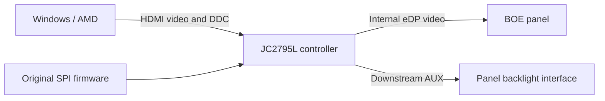

# What I changed on this hardware

[简体中文](技术说明.md) · **English** · [Home](../README.en.md)

This note describes my JC2795L_R40.1 / JC2795L001 controller, BOE NE160QDM-NM4 V8.5 panel, and the code version allowlisted in `tools/compatibility.json`. The repository includes my initialization stub and local file generator, not complete firmware or an automatic flasher.

## The controller sits between HDMI and the panel



Controlling brightness over DDC does not give a PC direct HDMI access to the panel's eDP AUX interface. During research, I used the controller's host-access interface and downstream AUX engine. Ordinary DDC, controller registers and panel DPCD are different layers.

The EDID helped identify the connected target. `RTK2775` does not identify the panel, prove the controller model or establish local-dimming support. The physical labels, PCB markings, CF23 chip read and firmware layout were considered together.

## The useful clue: Source OUI and a proprietary interface

The public Linux i915 implementation documents an Intel proprietary AUX backlight interface and a Source OUI wait mechanism. I used that as a hypothesis and checked the response on my device. I did not port the whole Linux driver to Windows.

| Panel address | Meaning used in this case |
| --- | --- |
| `0x300..0x302` | Source OUI |
| `0x340..0x343` | Proprietary interface capabilities |
| `0x341 bit3` | Segmented-backlight capability |
| `0x344 bit3` | Segmented-backlight control |

Initially the OUI was `00 04 4B`, and the proprietary capability bytes read as zero. A direct `0x344=08` write failed. After writing `00 AA 01` and waiting, capabilities appeared and `0x344=08` could be written and read back. This is a device observation, not a universal panel password.

I also tried the relevant standard eDP `0x721` bits. Readback changed, but fixed-brightness SDR/HDR comparisons did not show a clear optical change, so I did not adopt that route as the repair.

## Exact startup patch scope

The original image is 1 MiB, organized as sixteen 64 KiB banks. The patch uses existing bank-4 functions and a verified empty area:

| Location | Original / purpose | Change |
| --- | --- | --- |
| File offset `0x4D3B8` | `12 FA 8F`, original NativeWrite call | `12 FF 00`, call the new stub |
| `0x4FF00..0x4FF47` | All `FF` | Newly written 72-byte 8051 stub |
| `0xC0000..0xCFFFF` | Bank C, existing configuration | Preserved in full |

The new sequence:

1. Save temporary RAM `2B/2C/2D` and perform the original NativeWrite.
2. Put `00 AA 01` in the buffer and reuse the firmware's write routine for panel address `0x300`.
3. Wait 750 timer ticks using the original firmware's delay mechanism.
4. Write panel `0x344=08`, restore the temporary RAM and return.

**750 ticks is not an instrument-measured 750 milliseconds.** The complete new bytes are the [generator's STUB constant](../tools/build_startup_patch.py). Two bytes of the 72-byte stub are already `FF`; the call-site edit changes two bytes. The actual full-image difference is therefore also 72 bytes. That is not the erase size: my own deployment updated two 4 KiB sectors, with backups, sector checks and a complete image readback.

This did not adjust PQ decoding, color gamut or HDR calibration. Working local dimming does not establish that those features are calibrated.

## How the local generator restricts input

```powershell
py .\tools\build_startup_patch.py --input "my-original-backup.bin" --output "new-local-candidate.bin"
py -m unittest discover -s tests -v
```

The generator checks image length, then hashes **all bytes concatenated outside bank C**. Individual configuration can differ, while the code and every other region must match the reviewed version. It also checks the original call site, the entire 256-byte reserved area, permitted offsets, 72 actual differences, the output code digest and unchanged configuration. Repeated patching and existing output paths are rejected.

Full reference-image digests are identification data, not download links:

- Original reference: `e82d6cef7836bdb29c6223285626509b4ae4abfd686bd1029b2c3d5d0d976852`
- v2 reference candidate: `e387973e7e407aae3eb51d3671c7434f03bacb7c901a2347c12572c82a2ffaa5`

A different configuration produces a different full-image digest. Code digests are in [compatibility metadata](../tools/compatibility.json). A digest match identifies file contents, not your physical controller or panel.

The generator only reads and writes local files. It does not enter ISP, load a GPU DLL, contact a monitor or offer a flashing command. Producing a file is not a substitute for having an independently verified backup and recovery method for your board. The generated image retains third-party content; the tool's GPL license does not license that content.

## The failure that belongs in the report

**I have confirmed working local dimming overall. I have also confirmed that the PC toggle produces no visible difference.** Later ordinary E8 and direct panel reads could report an off configuration while the same black-background/white-object scene looked unchanged. Changing a UI label cannot turn that into optical success.

A later research bridge also changed Source OUI during runtime switching. It did not produce an optical toggle I accepted. Those runtime extensions are not included in the public startup generator. The public OSD retains optional E8 reads, removes switching writes, and disables the buttons and associated write hotkey.

Early verbal on/off observations were not strictly synchronized to asynchronous logs and do not override later direct feedback. Whether power cycling would change the result is untested. I have stopped this experiment; it should not be described as a supported toggle or another test waiting for me.

## What each check establishes

- Compilation and XAML loading: the public source builds and the interface parses.
- Synthetic tests: the generator's edit boundaries and rejection behavior, not hardware compatibility.
- Local reconstruction using my private original: the result equals the existing v2 candidate; that full image is not uploaded.
- My physical observations: overall local dimming works; manual switching has no visible effect.
- The two photographs: records with different exposure, framing and patterns, not controlled measurements.

Preparing this public release did not reflash the monitor, alter brightness or resume power-cycle experiments. See the [verification record](验证记录.json).

## Public references

- [Linux v6.12 Intel AUX backlight](https://github.com/torvalds/linux/blob/v6.12/drivers/gpu/drm/i915/display/intel_dp_aux_backlight.c): proprietary interface and segmented-backlight definitions.
- [Linux v6.12 Intel DP](https://github.com/torvalds/linux/blob/v6.12/drivers/gpu/drm/i915/display/intel_dp.c): Source OUI initialization and waiting.
- [Microsoft low-level monitor configuration](https://learn.microsoft.com/en-us/windows/win32/monitor/using-the-low-level-monitor-configuration-functions): Windows DDC/CI and VCP access.
- [AMD ADL I2C / DDC / EDID](https://gpuopen-librariesandsdks.github.io/adl/group__I2CDDCEDIDAPI.html): system interface used during research.

These sources supplied interface clues. Hardware identification, byte digests and optical observations come from my own case; the linked projects have not certified this patch.
