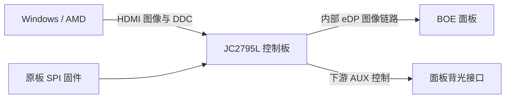

# 我在这套硬件上做了什么

**简体中文** · [English](technical-notes.en.md) · [返回首页](../README.md)

本说明对应 JC2795L_R40.1 / JC2795L001 驱动板、BOE NE160QDM-NM4 V8.5，以及 `tools/compatibility.json` 中的固件代码白名单。这里公开的是我的自编初始化片段和文件生成器，没有完整固件，也没有自动刷写器。

## 从 HDMI 到面板，隔着一个控制器



电脑端能用 DDC 调亮度，并不代表电脑可以直接用 HDMI 操作面板的 eDP AUX。我在研究时借助控制器的主机访问接口和下游 AUX 引擎，才读到了面板侧状态。普通 DDC、控制器寄存器、面板 DPCD 是三个不同层次。

EDID 只帮助我确认连接目标。`RTK2775` 不是面板型号，也不足以单独证明主控型号或分区功能。拆机标签、板号、实际芯片读值 CF23 和固件布局共同构成了本案例的识别依据。

## 关键线索：源端标识与专有背光接口

Linux i915 的公开实现给出了 Intel 专有 AUX 背光接口与 Source OUI 等待机制。我据此提出候选，再在自己的设备上核对响应；没有把 Linux 驱动整体移植到 Windows。

| 面板地址 | 本案例使用的含义 |
| --- | --- |
| `0x300..0x302` | Source OUI |
| `0x340..0x343` | 专有接口能力 |
| `0x341 bit3` | segmented backlight 能力 |
| `0x344 bit3` | segmented backlight 控制位 |

原状态下 OUI 为 `00 04 4B`，专有能力读回为零；直接写 `0x344=08` 没有成功。写入 `00 AA 01` 并等待后，能力出现，随后能写入并读回 `0x344=08`。这是本机观察，不是所有面板都遵守的通用口令。

标准 eDP `0x721` 的相关位也试过。虽然读回能变化，但固定亮度的 SDR/HDR 对照没有显示明显效果，所以没有采用它作为修复依据。

## 启动补丁的确切范围

原机镜像为 1 MiB，分为 16 个 64 KiB bank。补丁使用 bank 4 的原有函数和已核对的空白区域：

| 位置 | 原字节 / 用途 | 修改 |
| --- | --- | --- |
| 文件偏移 `0x4D3B8` | `12 FA 8F`，原 NativeWrite 调用 | `12 FF 00`，转入新片段 |
| `0x4FF00..0x4FF47` | 原来全部 `FF` | 72 字节自编 8051 片段 |
| `0xC0000..0xCFFFF` | bank C，原有配置 | 完整保留 |

新片段的执行顺序：

1. 保存临时 RAM `2B/2C/2D`，先执行原来的 NativeWrite。
2. 将 `00 AA 01` 放入缓冲区，复用原机函数写到面板 `0x300`。
3. 复用原固件的等待机制，等待 750 个定时 tick。
4. 写入面板 `0x344=08`，恢复临时 RAM，返回原流程。

**750 tick 不是仪器测得的精确 750 毫秒。** 自编字节在 [生成器的 STUB 常量](../tools/build_startup_patch.py) 中完整列出。72 字节片段中有两个字节恰好也是 `FF`，入口则变化两个字节，所以整片实际不同的字节总数仍为 72；这不等于实际擦写只有 72 字节。我自用部署更新的是两个 4 KiB 扇区，并在备份后逐扇区、整片读回核对。

没有修改 PQ 解码、色域或 HDR 色彩校准。分区效果有效不能推导出这些项目已经正确。

## 本地生成器如何限定输入

```powershell
py .\tools\build_startup_patch.py --input "自己的原始备份.bin" --output "新的本地候选.bin"
py -m unittest discover -s tests -v
```

生成器先检查文件长度，再对 **bank C 以外全部字节拼接计算 SHA-256**。这使配置可以保留个体差异，代码及其它区域必须与已核实版本逐字节对应。它还检查原入口、256 字节代码空洞全为 `FF`、修改范围、72 个实际差异、输出代码摘要和配置区不变。重复打补丁或已有输出会被拒绝。

完整参考镜像摘要仅用于辨认，不提供下载：

- 原始参考：`e82d6cef7836bdb29c6223285626509b4ae4abfd686bd1029b2c3d5d0d976852`
- v2 参考候选：`e387973e7e407aae3eb51d3671c7434f03bacb7c901a2347c12572c82a2ffaa5`

配置不同的设备生成整片摘要也会不同。代码摘要见 [兼容性元数据](../tools/compatibility.json)。匹配摘要只证明文件版本匹配，不能替代实物板型与面板确认。

生成器只读写本地文件，不进入 ISP、不调用显卡 DLL、不连接显示器，也不提供刷写命令。若不知道怎样独立备份和恢复自己的板子，生成文件并不等于已经具备部署条件。完整固件仍包含第三方内容；工具的 GPL 许可不替这些内容授权。

## 必须保留的失败结果

**我已经确认总体分区效果有效；我也已经确认电脑端开关没有产生可见差异。** 后续普通 E8 与直接面板读回可以显示“关闭”，同一黑底白块的视觉表现却没有跟着改变。这不能靠改一个状态标签变成成功。

后来还尝试了同时改变 OUI 的研究用运行时桥接扩展。它也没有取得我认可的光学切换效果。这些运行时扩展不在公开的启动补丁生成器里，公开 OSD 只保留可用时的 E8 读取，删除切换写入，停用开关按钮及对应写入快捷键。

早期“开黑关灰”的口述与异步日志没有严格同步，不能用来覆盖后来的直接反馈。是否要断电才生效没有验证，我也决定不继续这一轮实验。不要把它写成“已支持手动开关”或“等用户再试一次”。

## 软件检查和实物检查分别说明什么

- 编译与 XAML 加载检查：证明公开源码可生成程序、界面可解析。
- 合成数据测试：证明文件生成器的范围与拒绝条件，不证明硬件兼容。
- 用私有原备份在本机重建：证明生成结果与既有 v2 候选相同，不把该完整镜像上传。
- 用户实物观察：支持本机总体分区效果有效，手动切换没有可见作用。
- 两张照片：展示使用现象，曝光、图案和构图不同，不是受控测量。

本次公开整理没有重新刷屏、调整亮度或继续断电实验。检查记录见 [验证记录](验证记录.json)。

## 公开参考

- [Linux v6.12 Intel AUX backlight](https://github.com/torvalds/linux/blob/v6.12/drivers/gpu/drm/i915/display/intel_dp_aux_backlight.c)：专有接口与 segmented-backlight 位定义。
- [Linux v6.12 Intel DP](https://github.com/torvalds/linux/blob/v6.12/drivers/gpu/drm/i915/display/intel_dp.c)：Source OUI 初始化及等待。
- [Microsoft 低层显示器配置接口](https://learn.microsoft.com/en-us/windows/win32/monitor/using-the-low-level-monitor-configuration-functions)：Windows DDC/CI / VCP 访问方式。
- [AMD ADL I2C / DDC / EDID](https://gpuopen-librariesandsdks.github.io/adl/group__I2CDDCEDIDAPI.html)：研究阶段所用系统接口。

这些资料提供协议与接口线索；本案例的型号、字节摘要和效果结论来自我的设备及观察，不是上述项目对本补丁的认证。
